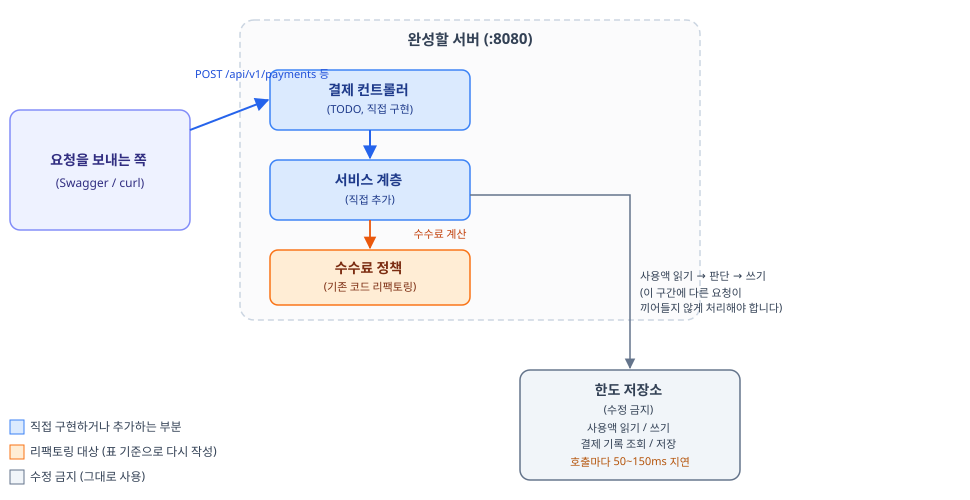
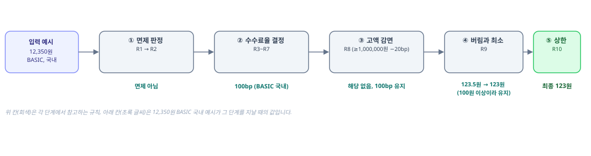

# 결제 한도 차감과 수수료 정책

> 백엔드 사전 과제 (문서 버전 v1.4, 2026-10-20)

> [!IMPORTANT]
> **과제 시작 전 확인 사항**
> - API 경로, 요청 및 응답 형식, 수수료 규칙 표는 반드시 그대로 지켜야 합니다. 이를 구현하는 방법은 자유롭게 정할 수 있습니다.
> - 시작 프로젝트의 기존 수수료 계산 코드는 규칙 표와 다르게 동작합니다. 코드가 아니라 **표가 기준**이며, 이 코드를 표에 맞게 고치는 것이 과제에 포함됩니다.

> [!TIP]
> - 처음이라면 3페이지 요약 자료 [`docs/requirements-overview.pdf`](docs/requirements-overview.pdf)로 전체 흐름을 먼저 본 뒤, 이 문서를 처음부터 끝까지 읽어 주세요.
> - 세부 요구사항은 이 문서를 기준으로 합니다.

## 과제 개요

- 시작 프로젝트의 결제 컨트롤러를 완성하고, 기존 수수료 계산 코드를 수수료 규칙 표에 맞게 고칩니다.
- 동시 요청이 몰려도 결과가 정확한 코드를 작성하는지, 그렇게 구현한 이유를 설명할 수 있는지를 봅니다.
- 한도 저장소(`LimitStore`)는 호출할 때마다 일부러 지연이 생기도록 만들었습니다. 한도를 확인하고 차감하는 사이에 다른 요청이 끼어들 수 있으니 주의해 주세요.
- 기술 스택은 Java 17, Spring Boot 4.1.1, Gradle이며 DB는 사용하지 않습니다. 제한 시간은 없습니다.

## 목차

- [과제 저장소 구성](#과제-저장소-구성)
- [1. 과제 소개](#1-과제-소개)
- [2. 구현 범위와 제공 자료](#2-구현-범위와-제공-자료)
- [3. 시작하기](#3-시작하기)
- [4. 용어 설명](#4-용어-설명)
- [5. API 명세](#5-api-명세)
- [6. 수수료 규칙](#6-수수료-규칙)
- [7. 문제 (6개)](#7-문제-6개)
- [8. 시나리오 체크리스트](#8-시나리오-체크리스트)
- [9. 서술 템플릿](#9-서술-템플릿)
- [10. 제출 방법](#10-제출-방법)
- [11. 평가 안내](#11-평가-안내)
- [12. 힌트](#12-힌트)

---

## 과제 저장소 구성

| 파일 및 폴더 | 용도 |
|---|---|
| `README.md` | 이 문서. 과제 설명, API 명세, 문제, 시나리오, 힌트 |
| [`docs/requirements-overview.pdf`](docs/requirements-overview.pdf) | 3페이지 분량의 과제 요약 자료 |
| `starter-project/` | 과제를 시작할 프로젝트. `TODO`가 있는 결제 컨트롤러, 한도 저장소, 기존 수수료 계산 코드가 들어 있습니다. **이 폴더가 제출 저장소의 최상위가 됩니다.** |
| `docs-template/answer.md` | 서술 템플릿. `starter-project/docs/answer.md`로 복사해서 작성해 주세요. |
| `requests.http` | 시나리오 확인용 요청 예시 (IntelliJ HTTP Client 형식). 다시 실행하려면 서버를 재시작해 주세요. |

## 1. 과제 소개

카드 결제 서버를 완성하는 과제입니다.

- 사용자마다 한도는 1,000,000원입니다.
- 결제를 승인하면 사용액이 결제 금액만큼 늘고, 취소하면 그만큼 줄어듭니다.
- 결제마다 수수료를 계산합니다.

요청이 동시에 몰릴 때도 다음과 같은 일이 생기면 안 됩니다.

- 같은 결제가 두 번 승인됨
- 동시에 들어온 결제 때문에 사용액이 한도를 넘음
- 사용액이 취소되지 않은 승인 결제 금액의 합과 달라짐

> [!TIP]
> 이 과제에서 확인하는 것은 다음 네 가지입니다.
> - 동시 요청에서도 결과가 정확한가
> - 수수료 규칙을 경계값까지 표대로 구현했는가
> - 구현이 맞다는 것을 테스트로 보여 주는가
> - 그렇게 구현한 이유를 글로 설명할 수 있는가

## 2. 구현 범위와 제공 자료

제공되는 것

- 시작 프로젝트
  - `TODO`가 있는 결제 컨트롤러
  - 수정할 수 없는 한도 저장소(`LimitStore`)
  - 기존 수수료 계산 코드(`LegacyFeeCalculator`)
  - 서버 실행만 확인하는 기본 테스트
- 이 문서와 서술 템플릿

직접 해야 하는 것

- `TODO` 구현
- 수수료 계산 코드 리팩토링 (4장 용어 설명 참고)
- 테스트 작성
- 서술 작성

조건

- 서버는 1대라고 가정하며, 외부 서비스는 없습니다.
- JPA와 DB는 사용하지 않습니다.

> [!IMPORTANT]
> **수정하면 안 되는 것** (경로는 `starter-project/src/main/java/com/practice/paymentlimit/` 기준)
> - 한도 저장소: `domain/payment/repository/LimitStore.java`
> - 결제 기록 클래스: `common/entity/PaymentRecord.java`, `common/enums/PaymentState.java`
> - API 경로와 요청 및 응답 형식
>   - `PaymentController`의 경로와 메서드 시그니처(메서드 이름, 매개변수, 반환 타입)
>   - 요청과 응답 클래스(`domain/*/model/`)와 에러 응답(`common/exception/ErrorResponse.java`)의 필드
>   - `Grade`, `PayType`, `ErrorCode`의 값 목록. 값을 바꾸지 않는다면 메서드나 필드를 추가하는 것은 괜찮습니다.
> - 설정 파일: `src/main/resources/application.yml`
>
> 그 밖의 부분은 자유롭게 수정하고 클래스를 추가해도 됩니다. 한도 저장소의 메서드는 호출해도 됩니다.

아래 그림은 서버 안에서 요청이 처리되는 구조입니다. 파란색은 직접 구현할 부분, 주황색은 리팩토링할 부분, 회색은 수정할 수 없는 부분입니다.



## 3. 시작하기

JDK 17이 필요합니다. Docker나 다른 서버는 필요하지 않습니다.

1. `starter-project/`를 IntelliJ에서 엽니다.
2. 서버를 실행합니다. 서버는 `8080` 포트에서 실행됩니다.
   ```bash
   ./gradlew bootRun
   ```
3. 테스트를 실행합니다.
   ```bash
   ./gradlew test
   ```

## 4. 용어 설명

| 용어 | 뜻 |
|---|---|
| **한도** | 사용자마다 1,000,000원으로 고정된 값입니다. 응답 필드는 `dailyLimit`입니다. 이름에 daily가 있지만 날짜별 초기화는 하지 않습니다. |
| **사용액** | 응답 필드 `usedAmount`. 승인하면 결제 금액만큼 늘고, 취소하면 그만큼 줄어듭니다. |
| **잔여 한도** | 응답 필드 `remainingLimit`. 한도에서 사용액을 뺀 값입니다. |
| **경쟁 상태 (race condition)** | 여러 요청이 같은 데이터를 동시에 수정할 때 결과가 어긋나는 문제 |
| **확인 후 실행 (check-then-act)** | 잔여 한도를 확인한 뒤 차감하는 것처럼, 확인과 실행 사이에 다른 요청이 끼어들 수 있는 코드 패턴 |
| **락 (잠금)** | 코드의 특정 부분을 한 번에 한 요청만 실행하도록 하는 장치. 무엇을 기준으로 잠그는지에 따라 결과와 성능이 달라집니다. |
| **불변 조건** | 언제나 참이어야 하는 규칙. 이 과제에서는 `사용액 = 취소되지 않은 승인 결제 금액의 합`입니다. |
| **경계값** | 규칙이 바뀌는 값과 그 앞뒤 값 (예: 999원과 1,000원) |
| **원 단위 미만 버림** | 계산 결과에서 1원 미만을 버리는 것. 반올림과 결과가 다릅니다. (예: 123.5원 → 123원) |
| **리팩토링** | 코드를 읽기 쉽게 정리하는 것. 이 과제에서는 기존 수수료 계산 코드의 결과를 규칙 표에 맞게 고치면서 구조도 정리하는 것을 말합니다. |

---

## 5. API 명세

### 5-1. 에러 응답 형식 (모든 API 공통)

```json
{ "code": "LIMIT_EXCEEDED", "message": "한도를 초과했습니다.", "paymentId": "P-1001" }
```

- `paymentId`는 알 수 없을 때 생략됩니다.
- 아래 표의 "에러 본문"은 이 형식을 말합니다.

### 5-2. 결제 승인

`POST /api/v1/payments`

```json
{ "paymentId": "P-1001", "userId": "U-1", "amount": 50000, "grade": "GOLD", "payType": "DOMESTIC" }
```

| 필드 | 규칙 |
|---|---|
| `paymentId` | 결제 ID. 필수, 1~50자. 사용자가 달라도 같은 결제 ID는 한 번만 승인됩니다. |
| `userId` | 사용자 ID. 필수, 1~50자 |
| `amount` | 결제 금액(원). 정수, 1 이상 100,000,000 이하 |
| `grade` | `BASIC`, `SILVER`, `GOLD`, `VIP` 중 하나 |
| `payType` | `DOMESTIC`(국내), `OVERSEAS`(해외) 중 하나 |

**응답**

| 상황 | 상태 코드 | 본문 |
|---|---|---|
| 승인 | **200** | `{"paymentId":"P-1001","userId":"U-1","amount":50000,"fee":250,"status":"APPROVED","remainingLimit":950000}` |
| 입력 오류 | **400** | 에러 본문 (`INVALID_REQUEST`) |
| 이미 있는 결제 ID | **409** | 에러 본문 (`DUPLICATE_PAYMENT`) |
| 한도 초과 | **422** | 에러 본문 (`LIMIT_EXCEEDED`) |

**승인 요청 검사 순서**

1. 입력 검증 (400)
2. 결제 ID 중복 (409)
3. 한도 (422)
4. 승인 (200)

### 5-3. 결제 취소

`POST /api/v1/payments/{paymentId}/cancel`

| 상황 | 상태 코드 | 본문 |
|---|---|---|
| 취소 성공 | **200** | `{"paymentId":"P-1001","status":"CANCELED","restoredAmount":50000,"remainingLimit":1000000}` |
| 없는 결제 | **404** | 에러 본문 (`PAYMENT_NOT_FOUND`) |
| 이미 취소됨 | **409** | 에러 본문 (`ALREADY_CANCELED`) |

### 5-4. 한도 조회

`GET /api/v1/users/{userId}/limit`

```json
{ "userId": "U-1", "dailyLimit": 1000000, "usedAmount": 50000, "remainingLimit": 950000 }
```

결제한 적이 없는 사용자를 조회하면 오류 대신 `usedAmount` 0, `remainingLimit` 1,000,000을 응답합니다.

### 5-5. 수수료 계산

`GET /api/v1/fees?grade=GOLD&payType=DOMESTIC&amount=50000`

```json
{ "grade": "GOLD", "payType": "DOMESTIC", "amount": 50000, "fee": 250 }
```

- `amount`는 승인 API와 같이 1 이상 100,000,000 이하입니다.
- 입력이 잘못되면(값 누락, 범위 밖 금액, 없는 등급이나 유형) 400(`INVALID_REQUEST`)을 응답합니다.
- 같은 입력이라면 승인 API 응답의 `fee`와 같은 값이어야 합니다.

### 5-6. 한도와 결제 기록 규칙

| 규칙 | 내용 |
|---|---|
| 한도 | 사용자마다 1,000,000원. 날짜별 초기화는 구현하지 않습니다. |
| 사용액 증가분 | 결제 금액(`amount`)만큼만 늘어납니다. **수수료는 더하지 않습니다.** |
| 승인 조건 | `사용액 + 이번 결제 금액 ≤ 1,000,000` |
| 취소 | 사용액에서 해당 결제 금액을 뺍니다. |
| 승인된 결제 | 취소해도 기록이 지워지지 않고 `CANCELED` 상태로 남습니다. 그래서 그 결제 ID로 다시 승인을 요청하면 409(`DUPLICATE_PAYMENT`)입니다. |
| 거절된 결제 (422) | 기록하지 않습니다. 같은 결제 ID로 다시 요청할 수 있습니다. |
| 항상 지켜야 할 조건 | `사용액 = 취소되지 않은 승인 결제 금액의 합`, `사용액 ≤ 1,000,000` |

---

## 6. 수수료 규칙

수수료율을 bp 단위(1bp = 0.01%)로 다루면 정수로 계산할 수 있습니다. 예를 들어 1.00%는 100bp입니다.

| # | 규칙 |
|---|---|
| R1 | 금액이 **1,000원 미만**이면 수수료는 **0원**입니다. (면제) |
| R2 | 등급이 **VIP**이고 **국내** 결제이면 수수료는 **0원**입니다. (면제) |
| R3 | 기본 수수료율은 국내 **1.00%**, 해외 **3.00%**입니다. |
| R4 | **SILVER**는 기본 수수료율에 **0.8**을 곱합니다. (국내 0.80%, 해외 2.40%) |
| R5 | **GOLD**는 기본 수수료율에 **0.5**를 곱합니다. (국내 0.50%, 해외 1.50%) |
| R6 | **VIP** 해외 결제는 기본 수수료율과 관계없이 **1.50%**입니다. |
| R7 | **BASIC**은 기본 수수료율을 그대로 씁니다. |
| R8 | 금액이 **1,000,000원 이상**이면 R3~R7로 정한 수수료율(VIP 해외 1.50% 포함)에서 **0.20%p**를 뺍니다. %p(퍼센트포인트)는 비율이 아니라 값 자체를 뺀다는 뜻입니다. (예: 1.00% → 0.80%, 1.50% → 1.30%) |
| R9 | 수수료는 `금액 × 수수료율`에서 **원 단위 미만을 버린** 값입니다. 면제가 아니면 **최소 100원**입니다. |
| R10 | 수수료는 **최대 50,000원**입니다. |

**R3~R7로 정한 수수료율** (R8 감면 전)

| 등급 | 국내 | 해외 |
|---|---|---|
| BASIC | 1.00% | 3.00% |
| SILVER | 0.80% | 2.40% |
| GOLD | 0.50% | 1.50% |
| VIP | 면제 (R2) | 1.50% |

규칙은 다음 순서로 적용합니다.

1. 면제 확인 (R1 다음 R2). 면제에 해당하면 0원으로 끝내고 아래 단계는 건너뜁니다.
2. 수수료율 결정 (R3~R7)
3. 고액 감면 (R8)
4. 원 단위 미만 버림과 최소 수수료 (R9)
5. 최대 수수료 (R10)

아래 그림은 12,350원 BASIC 국내 결제가 5단계를 거쳐 수수료 123원이 되는 과정입니다.



**계산 예시**

| 금액 | 등급 | 유형 | 수수료 | 설명 |
|---|---|---|---|---|
| 999 | BASIC | 국내 | 0 | 1,000원 미만이라 면제 (R1) |
| 1,000 | BASIC | 국내 | 100 | 계산 결과는 10원이지만 최소 수수료 100원 적용 |
| 12,350 | BASIC | 국내 | 123 | 123.5원에서 원 단위 미만을 버림 |
| 999,999 | BASIC | 국내 | 9,999 | 고액 감면 대상이 아님 |
| 1,000,000 | BASIC | 국내 | 8,000 | 고액 감면 적용 (0.80%) |
| 1,000,000 | VIP | 해외 | 13,000 | VIP 해외 1.50%에 고액 감면 적용 (1.30%) |
| 5,000,000 | VIP | 국내 | 0 | 면제(R2)가 먼저 적용됨 |
| 10,000,000 | BASIC | 해외 | 50,000 | 계산 결과는 28만 원이지만 최대 수수료 적용 |

> [!WARNING]
> 시작 프로젝트에 들어 있는 기존 수수료 계산 코드는 이 표와 다르게 동작하는 부분이 있습니다. 기존 코드가 아니라 이 표를 기준으로 구현해 주세요.

---

## 7. 문제 (6개)

1번부터 순서대로 푸는 것을 권장합니다. 6개 문제를 모두 풀어서 제출해 주세요.

### 문제 1. 결제 승인, 취소, 한도 조회 구현 (구현)

- 결제 컨트롤러의 `TODO`를 구현합니다. 5장의 규칙을 모두 지켜야 합니다.
- 요청이 동시에 들어와도 아래 조건이 지켜져야 합니다.
  - 같은 결제 ID는 1건만 승인하고, 나머지 요청에는 409를 응답합니다. 서로 다른 사용자가 같은 결제 ID로 요청해도 마찬가지입니다.
  - 같은 사용자의 서로 다른 결제가 동시에 들어와도 사용액이 한도를 넘지 않고, 사용액이 취소되지 않은 승인 결제 금액의 합과 같아야 합니다.
  - 같은 결제의 취소 요청이 동시에 여러 번 들어와도 사용액은 한 번만 줄어듭니다.
- 한도 저장소는 수정할 수 없고, 호출할 때마다 시간이 걸립니다. 동시 요청 처리는 한도 저장소를 호출하는 서비스 코드에서 해 주세요.

### 문제 2. 동시성 검증 테스트 작성 (테스트)

- 문제 1의 동시성 조건이 실제로 지켜지는지 확인하는 테스트를 작성합니다. 검증 방법은 자유입니다.
- 테스트를 작성할 때 다음을 참고해 주세요.
  - 스레드와 래치(`CountDownLatch`: 여러 스레드를 한꺼번에 출발시키는 도구)를 사용해 요청을 실제로 동시에 보냅니다.
  - 성공한 요청 수(예: 1건만 성공)와 최종 사용액을 함께 확인합니다.
  - 테스트마다 `limitStore.resetForTest()`로 한도 저장소를 비우고, 직접 만든 서비스에 상태가 있다면 그것도 함께 초기화해서, 몇 번을 실행해도 같은 결과가 나오게 합니다.

### 문제 3. 수수료 정책 구현과 리팩토링 (구현)

- 6장의 규칙 표대로 수수료를 계산합니다. 기존 코드를 고쳐도 되고 새로 작성해도 됩니다.
- 계산 결과가 표와 같아야 하고, 규칙 하나(R1~R10)가 코드의 어느 부분인지 바로 찾을 수 있어야 합니다.
- 승인 API의 `fee`와 수수료 계산 API의 `fee`는 같은 값이어야 합니다.

### 문제 4. 수수료 정책 검증 테스트 작성 (테스트)

- 규칙이 바뀌는 경계값과 여러 규칙이 겹치는 경우를 확인하는 테스트를 작성합니다.
- 예
  - 경계값: 999원과 1,000원, 999,999원과 1,000,000원, 최소 수수료와 최대 수수료
  - 여러 규칙이 겹치는 경우: GOLD 해외 1,000,000원(등급 할인과 고액 감면), VIP 해외 500원(면제와 VIP 수수료율)

### 문제 5. 풀이 이유 설명 (서술)

- 문제 1~4를 어떻게 풀었는지, 그 방법을 고른 이유가 무엇인지 적어 주세요.
- 다른 방법과 비교해서 설명하면 더 좋습니다.

### 문제 6. 가장 어려웠던 문제 설명 (서술)

이번 과제에서 가장 어려웠던 문제 하나를 골라 다음 순서로 적어 주세요.

1. 어떤 문제였는지
2. 원인을 어떻게 찾았고, 어떻게 해결했는지
3. 결과가 어땠고, 무엇을 배웠는지

---

## 8. 시나리오 체크리스트

서버는 아래 모든 시나리오에서 기대 결과대로 동작해야 합니다.

| # | 시나리오 | 기대 결과 |
|---|---|---|
| S1 | 정상 승인 | 200, 수수료와 잔여 한도가 맞음 |
| S2 | 앞 요청이 끝난 뒤 같은 결제 ID로 다시 승인 요청 | 409 `DUPLICATE_PAYMENT`. 사용액은 한 번만 늘어남 |
| S3 | 같은 사용자가 같은 결제 ID로 **동시에** 여러 번 요청 | **1건만 200**, 나머지 409. 사용액은 1건 금액만큼만 늘어남 |
| S4 | **서로 다른 사용자**가 같은 결제 ID로 동시에 요청 | **1건만 200**, 나머지 409 |
| S5 | 같은 사용자의 **서로 다른 결제**가 동시에 들어오고, 합계가 한도를 넘음 | 한도 안에서만 승인하고 나머지는 422. 사용액이 승인된 결제 금액의 합과 같음 |
| S6 | 한도 경계 | 1,000,000원까지는 승인, 1원이라도 넘으면 422. 거절된 결제 ID로 나중에 다시 요청하면 한도 안일 때 200 |
| S7 | 입력 오류 | 승인 API와 수수료 API 모두 400 |
| S8 | 승인된 결제 취소 / 없는 결제 취소 | 승인된 결제는 200과 사용액 감소, 없는 결제는 404 |
| S9 | **같은 결제의 취소** 요청이 동시에 여러 건 | **1건만 200**, 나머지 409. 사용액은 한 번만 줄어듦 |
| S10 | 취소한 결제 ID로 다시 승인 요청 | 409. 사용액은 바뀌지 않음 |
| S11 | **승인과 취소가 섞여** 동시에 들어옴 | 처리 순서와 관계없이 최종 사용액이 취소되지 않은 승인 결제 금액의 합과 같음 |
| S12 | 수수료 규칙 (경계값 포함) | 모든 입력에서 표와 같은 수수료 |

S5 예시: 한도가 1,000,000원인 사용자에게 400,000원 결제 3건이 서로 다른 결제 ID로 동시에 들어오면 2건은 승인, 1건은 거절되고 사용액은 800,000원이어야 합니다.

---

## 9. 서술 템플릿

`starter-project/docs/answer.md`에 아래 제목을 그대로 사용해 작성해 주세요. 괄호 안 안내문은 지우고 작성합니다.

```markdown
# 서술

## 문제 5. 풀이 이유

### 5-1. 동시성 처리 방식과 이유
(동시 요청 문제를 어떤 방법으로 막았는지, 락의 범위는 어디까지인지, 다른 방법 대신 이 방법을 고른 이유)

### 5-2. 수수료 정책 구현 방식과 이유
(규칙을 어떤 구조로 나눴는지, 적용 순서를 어떻게 지켰는지, 그렇게 한 이유)

### 5-3. 테스트 설계와 이유
(무엇을 어떻게 검증했는지, 그 테스트로 충분하다고 판단한 이유)

### 5-4. 중요하게 생각한 점
(설계에서 가장 우선한 기준과 그 이유)

## 문제 6. 가장 어려웠던 문제

### 6-1. 문제 상황

### 6-2. 원인 파악과 해결 과정

### 6-3. 결과와 배운 점
```

## 10. 제출 방법

- `starter-project/` 폴더 안의 파일이 제출 저장소의 최상위에 오도록 올려 주세요. 이 장에서 말하는 루트는 이 폴더입니다.
- 루트에 제출 README(`README.md`)와 서술(`docs/answer.md`)을 둡니다.
  - 제출 README는 `starter-project/README.md`의 내용을 지우고, 실행 방법과 직접 확인한 시나리오로 바꿔 써 주세요.
- 루트에서 `./gradlew bootRun`으로 실행되어야 하며, 포트는 8080입니다.
- 루트에서 `./gradlew test`를 실행했을 때 모든 테스트가 통과해야 합니다.
- 2장의 수정하면 안 되는 것은 바꾸지 않습니다.

## 11. 평가 안내

| 영역 | 배점 | 내용 |
|---|---|---|
| A. 정확성 | 40 | 동시성, 중복, 한도 시나리오 20점, 수수료 규칙 20점 |
| B. 테스트 작성 | 25 | 동시성 테스트, 경계값 테스트, 반복 실행 시 같은 결과 |
| C. 서술 | 20 | 풀이 근거, 어려웠던 문제 설명 |
| D. 코드와 리팩토링 | 15 | 규칙 정리, 구조, 에러 응답, 수정 금지 항목 준수 |
| **합계** | **100** | |

> [!WARNING]
> 다음 경우에는 크게 감점됩니다.
> - 사용액이 한도를 넘어 승인되거나, 같은 결제 ID가 두 번 승인됨
> - 서버가 실행되지 않거나 테스트가 통과하지 않음

## 12. 힌트

구현하다 막혔을 때 하나씩 열어 보세요.

<details>
<summary><b>힌트 1: 어디에서 문제가 생기는가</b></summary>
<br>

사용액을 읽고, 한도를 확인하고, 사용액을 쓰는 세 단계 사이에 다른 요청이 끼어들 수 있습니다. 한도 저장소가 일부러 느리게 동작하기 때문에 이 틈이 더 커집니다.

</details>

<details>
<summary><b>힌트 2: 락의 범위</b></summary>
<br>

무엇을 기준으로 잠가야 서로 다른 사용자의 결제는 동시에 처리하면서 같은 사용자의 결제는 하나씩 처리할 수 있을까요? 또 서로 다른 사용자가 같은 결제 ID를 보내는 경우에도 그 락으로 막을 수 있는지 확인해 보세요.

</details>

<details>
<summary><b>힌트 3: 결제 ID 중복</b></summary>
<br>

이미 있는지 확인한 뒤 저장하는 방식은, 같은 요청이 동시에 오면 둘 다 기존 결제가 없다고 판단할 수 있습니다. 결제 기록을 저장하기 전에 이 결제 ID를 처리 중 상태로 먼저 등록해 두는 방법(선점)을 생각해 보세요. 등록에 실패한 요청은 중복입니다. 한도 초과로 거절되면 등록을 지워서, 같은 결제 ID로 다시 요청할 수 있게 해야 합니다.

</details>

<details>
<summary><b>힌트 4: 수수료</b></summary>
<br>

규칙을 조건문 하나에 몰아넣지 말고 적용 순서대로 단계를 나눠 보세요. 소수 대신 정수(bp)로 계산하면 오차가 생기지 않습니다. 원 단위 미만을 버리는 것과 반올림은 결과가 다르다는 점도 확인해 주세요.

</details>

<details>
<summary><b>힌트 5: 테스트</b></summary>
<br>

동시성 테스트는 여러 요청을 한꺼번에 출발시켜야 의미가 있습니다. 성공한 요청 수와 실패한 요청 수를 세고, 마지막에 한도 조회로 사용액을 확인해 보세요.

</details>
